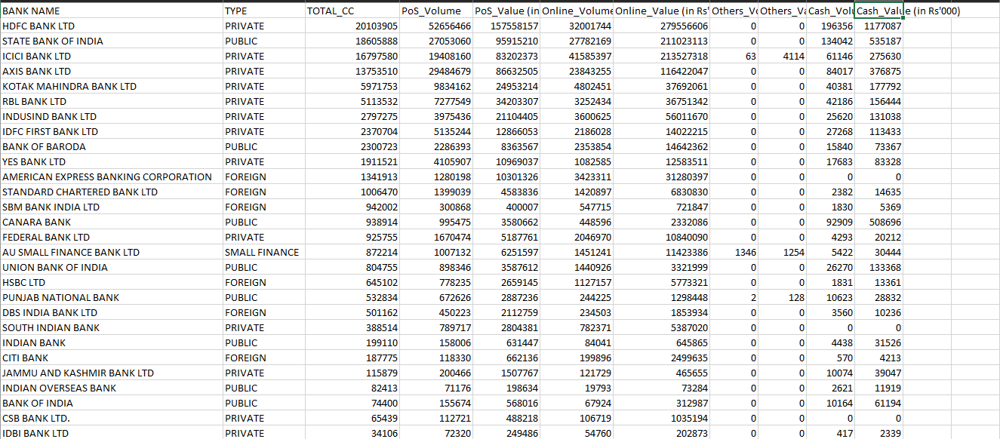
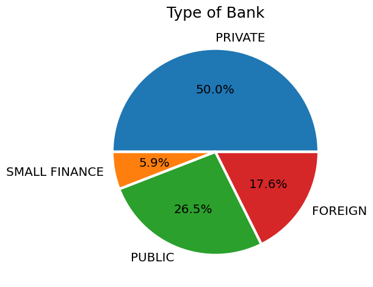
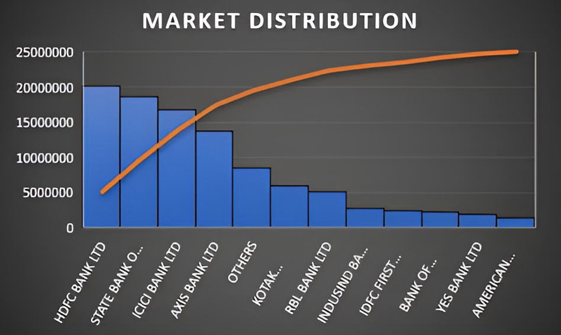
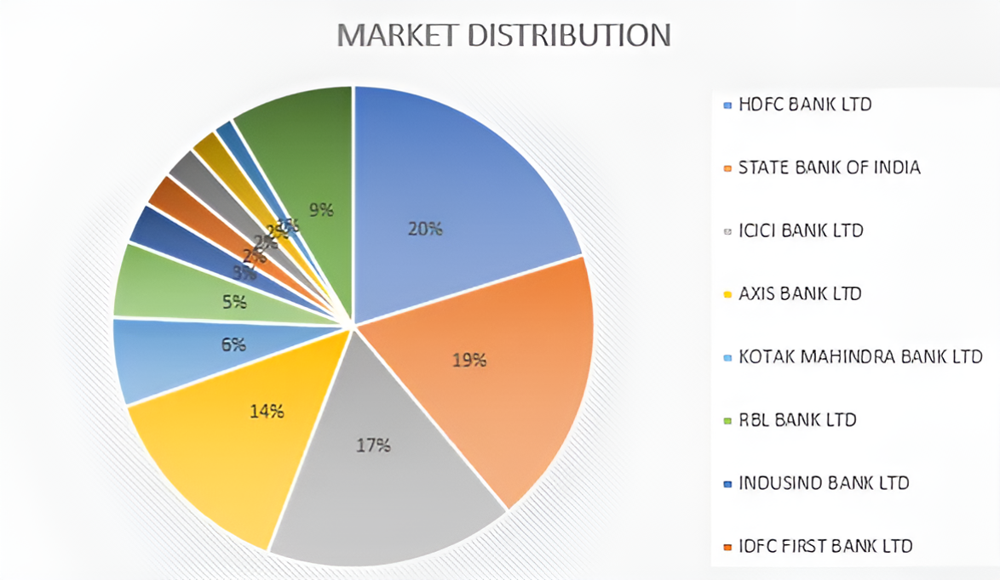
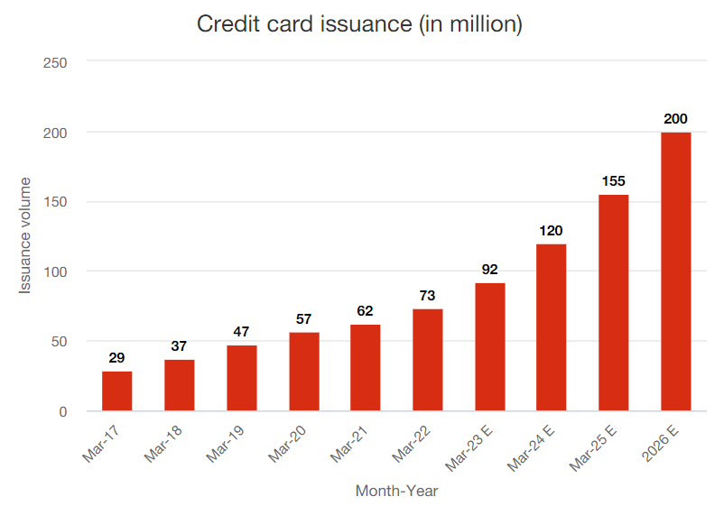
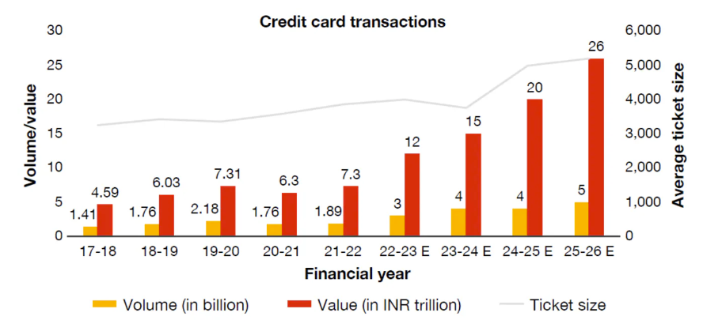
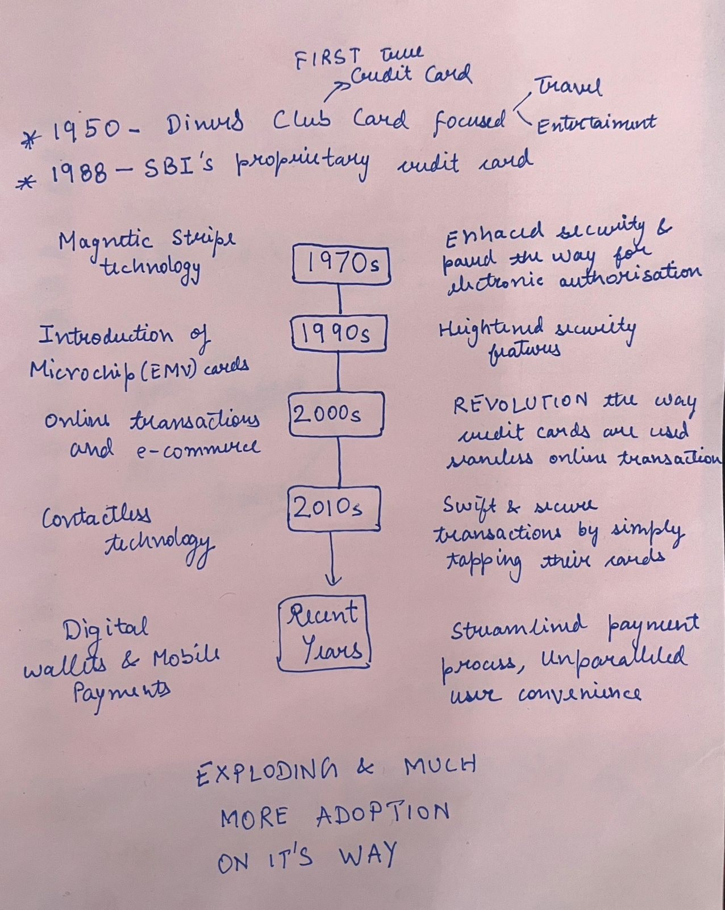

<!-- Imported verbatim from Substack (https://abhishekvyas02032001.substack.com/p/a-piece-of-plastic), first published 2024-03-14T02:08:48.716Z. -->
# Plastic Money

As the digital age ushers in an era of cashless transactions and financial finesse, there's one little plastic card that holds a universe of possibilities: the credit card. Much like a magic wand in the hands of a skilled (*delusionally skilled*, to be honest) wizard, it grants the power to purchase now and pay later, but with great power comes great responsibility—and perhaps a dash of confusion.

### 1\. The State of the Credit Card Industry in India

To delve into the credit card industry of India, I analysed the [RBI’s bank's ATM/POS/CARD STATISTICS](https://www.rbi.org.in/scripts/atmview.aspx) for January-2024 and came across some intriguing insights about the current market landscape, including key players, market size, and growth trends (PoS-Point of Sales).

Below is a snapshot of cleaned Credit Card data

Some graphs for data peeps:

The Chart shows ***‘Private’ banks being the Top-G***, followed by ‘Public’ banks mainly because of more rewards provided by Private bank, luring more people (umm capitalism)

Bank-wise number of Credit cards issued

Percentage wise Market Distribution

Both graphs indicate the presence of only a ***few big players*** dominating the industry, mainly because of better and more diverse card choices for a diverse range of users.(More blogs about each of them.)

## **2\. FUTURE Trends**

The popularity of credit cards in India is on the rise, with the latest data from the RBI indicating a surge in usage. In December 2023, the number of outstanding cards reached **97.9 million**, with a remarkable addition of **1.9 million cards** in that month alone. In January 2024, the number of outstanding cards reached **99.5 million**, with another outstanding addition of **1.6 million cards**.

This trend reflects a dynamic shift in the credit card landscape, as major banking institutions are introducing new regulations and expanding their range of products and services.

Source: RBI data and PwC payments handbook 2021–22

Source: RBI data and PwC payments handbook 2021–22

Card-based transactions are projected to experience ***16% year-on-year growth*** over the next four years. Additionally, the RBI Payments Vision 2025 forecasts a significant expansion in card acceptance infrastructure, reaching 250 lakh touchpoints, thereby facilitating increased transactions throughout India. Furthermore, there has been a consistent growth in the average transaction size by 7.3% following a recovery from the decline observed in FY 2019–20. This trend underscores a heightened preference among consumers for utilizing credit cards as a payment method for larger purchases.

### 3\. The Evolution- plastic to power

Credit cards are an example of simple innovation in the constantly changing world of finance. The path of credit cards, from their *modest origins* to their current status as essential tools for *modern-day transactions*, represents the dynamic growth of market dynamics, consumer behaviour and so much more

A brief history of Credit Cards in India

In India, the sector is still relatively untapped, with just ***3% of people*** possessing a formal credit card. When it comes to credit cards, the Indian population has always operated conservatively and has largely avoided using them (my mother is still upset at me for having a credit card :/ )

Major participants in the payments ecosystem, however, are now trying to alter the current situation by bringing about a number of improvements and raising awareness of the use of credit cards in regular transactions.

### 4\. **Key trends in the credit card space (India)**

- *FinTech Disruption*:

  - The credit card issuance space is witnessing a wave of disruption fueled by the emergence of **FinTechs, new-age banks, and OEMs**. These entities are forging co-branded partnerships with traditional banks, offering customers unparalleled services and benefits, thus challenging the conventional norms of the industry.

- *Enhanced Mobile Applications*:

  - Customers today expect mobile apps with top-notch UX/UI design, a plethora of features, and **self-service functionalities**, prompting issuers to revamp their offerings to meet these heightened expectations.

- *Innovative Risk Models*:

  - Card issuers are venturing beyond the confines of traditional credit rating models, exploring innovative approaches to assess credit risk.

  - These new models are designed to cater to a diverse customer base, including those with **limited or no credit history**, thereby promoting financial inclusion and widening the reach of credit card services.

- *Rise of Contactless Payments*:

  - With the proliferation of mobile technology, there is a notable shift towards **contactless payment methods** such as QR codes, token payments, and mobile-based transactions.

By staying attuned to evolving consumer preferences and leveraging technological advancements, credit card issuers can carve out a competitive edge in an increasingly digital and customer-centric market environment.

### 5\. Conclusion and Future Blogs

We have established some things in this section of the blog:

- With 99.5 million credit cards in January 2024 and more and more credits on the way, credit card could (still, along with UPI-BNPL) be “FINTECH” product of next chapter of India so we should educate us more about this (read my future blogs as well, please)

- With new competition from companies like CRED to established banking institutions and the competition of BNPL-UPI-Credit Card, this conservative approach to these new fintech products will change, *Gen-Z* should avoid credit mistakes by their corresponding *Millennials*

Future blogs I am aiming for:

1. **Credit Card: Everything essential for a new user**

2. **Reward System of Credit Cards**

3. **CRED app case-study**

4. **Evolution in the credit card business models**

5. **Market evolution for credit cards**

6. **Hyper-personalisation for credit cards**

### P.S. Why blog??

I have started this blog substack for a specific selfish reason: to be better at things that flash across my curious mind, whether it be Credit Card, Machine Learning, Venture Capital, Generative AI, Game of Thrones fanfiction, ANYTHINGG

So I will be publishing a blog every week. (Sometimes may be good, Sometimes may be shit.) just a humble start like credit cards

### 6\. Sources

1. Bankwise ATM/PoS/CARD Statistics:RBI

2. RBI data and PwC payments handbook 2021–22

3. [India's e-commerce market to surge 84% to $111 billion by 2024: FIS report](https://timesofindia.indiatimes.com/business/india-business/indias-e-commerce-market-to-surge-84-to-111-billion-by-2024-fis-report/articleshow/81430622.cms)

4. PwC analysis of data from industry sources

* * *
