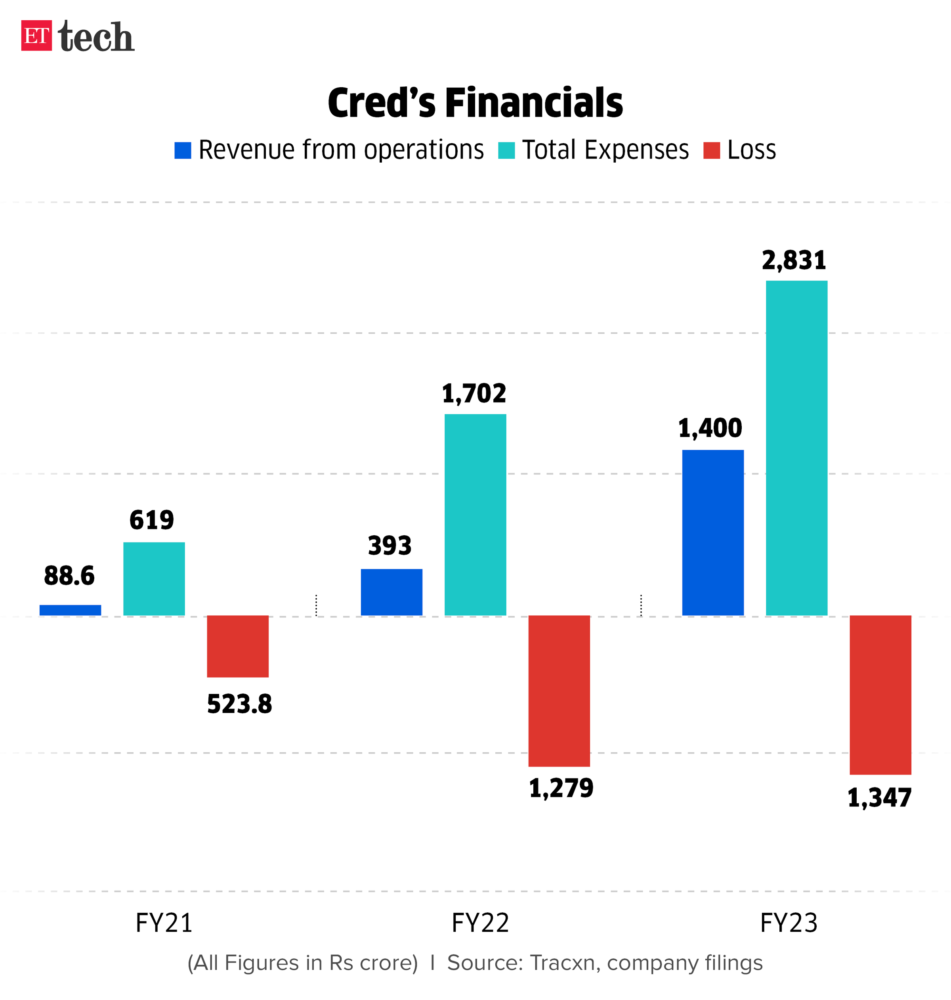
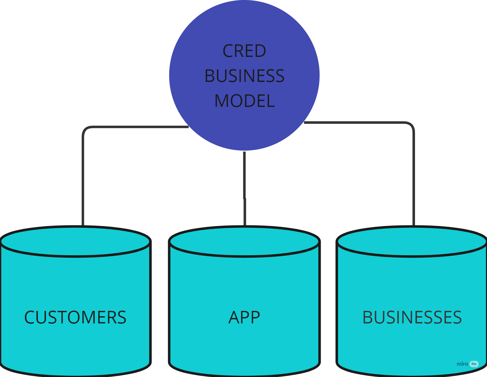
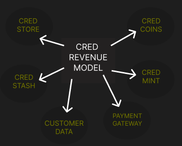

<!-- Imported verbatim from Substack (https://abhishekvyas02032001.substack.com/p/curious-case-of-cred), first published 2024-03-18T22:14:48.702Z. -->
Many of us have seen the rare scenes of Rahul Dravid being angry in ads, Neeraj Chopra being an actor, These are all curious ads for CRED.

Source: CRED, obviously

Source: CRED

### 1\. How was CRED started?

CRED was founded by Kunal Shah in 2018, and it has a cute, wholesome backstory. In 2015, Kunal Shah's first startup, Snapdeal, was acquired for 400 million dollars. He travelled, conducted polls, and came across a concept incorporated in developed countries: ***“Behavior Incentivization”***. People trust each other more in financial matters, like at groceries, cashiers, unlike in India, where we trust none when it comes to financial matters, so this is how CRED started.

CRED transcends the typical bill payment application, incentivizing punctuality with rewards and granting users access to exclusive perks, fundamentally reshaping the perception and implementation of credit card management.

During an era focused on penalizing late credit bill payments, CRED diverged by the market via

- Rewarding timely settlements. Through its app, users can scrutinize concealed charges tied to their credit cards via comprehensive spending analyses.

- CRED not only issues payment reminders but also furnishes cashback and rewards to prompt repayments.

Despite the prevailing belief that CRED merely facilitates credit card bill payments, the truth diverges significantly. CRED's endeavors extend beyond conventional expectations, delving into realms largely unnoticed but remarkably potent, challenging the boundaries of imagination (a new startup idea landmine).

## 2\. What does CRED do?

First, to use the CRED app, the user needs to have a CIBIL score greater than 750, i.e., the top 1%, so that CRED can create a community of trustworthy, responsible individuals who have a history of repaying their credit bills on time, So I sort of see why they have chosen a minimum 750 CIBIL score and have succeeded in making a good community with an improvement in the overall credit behavior of its users.

> DATA PEEPS FOCUS
> 
> Cred’s member community grew nearly 50% to 11.2 million users in FY22. In the calendar year 2022, the company scaled this number to 16 million. [Source](https://www.livemint.com/companies/news/monetizing-users-the-next-chapter-for-cred-kunal-shah-11675958905765.html)
> 
> 

But road to profit looks uphill but credit card industry is evolving and will increase in India (my previous blog covers it; [read it here](https://open.substack.com/pub/abhishekvyas02032001/p/a-piece-of-plastic?r=7qsfc&utm_campaign=post&utm_medium=web)) so let us see what Kunal Shah and co are cooking

## 3\. CRED Revenue Model

CRED business model is built on three pillars- Customers-**App**\-Businesses

- CRED Store

  - Selection of products and experiences at special prices to which customers can get access via coins received by our credit card payments.

  - Revenue source: Fee & commissions from Brands

- CRED Coins

  - Simple: pay credit card bills on time—get coins—buy and redeem them via products, experiences, etc

  - Revenue source: Fee & commissions from that brand upon purchase

- CRED Stash

  - Collaboration of CRED & partnered banks to provide loans to users with no registration charges

- CRED Mint

  - Peer-to-Peer lending product, with 9% for lenders and 15% for borrowers, has been disbursed over Rs. 2000 crore

- Customer Data

  - I came across these via one of the posts on LinkedIn, Under RBI regulations, CRED can’t sell user data but but but they can provide consultancy to firms, analysis, and trends, so this should be a good revenue source for CRED.

  - Chance to propose new offers to their users utilising this data

- Payment Gateway

  - Provide direct-to-consumer (D2C) channels with a seamless payment process directly on their platforms, ensuring instant payment convenience for users.

  - I mentioned this as one of the mode of revenue but I could be wrong because of CRED’s declaration on payments

    > “Cred has revealed that it does not charge any fees for the credit card payment options available on its app. Instead, the company generates revenue from additional services provided through its technology and distribution network.” [Source](https://www.businessoutreach.in/success-story-of-cred)

There are more products and services available, like CRED Rentpay (I didn’t cover these because of RBI’s recent crackdown on peer-to-peer credit card transactions, [read it here](https://www.thehindubusinessline.com/money-and-banking/rbi-cracking-down-on-p2p-credit-card-transactions/article67936134.ece)) , CRED Travel, CRED Garage, Insurance and more

## 4\. Things I like to build/add in CRED

HYPERPERSONALIZATION: There is just a reward system for customers, not any way to pick up the credit cards matching their income, spending, and reward preferences.

CRED wants good CIBIL score users to pay their bills, spin the jackpot, make payments, and use coins, but the background profile of the user is so important. How they spend, what they want to purchase, and which reward would they prefer more—an Amazon voucher or more cashbacks?

There’s some work to do in this credit card industry and let see where and who *swipes (intentional pun, sorry)* the big players

Image credit: TechCrunch

Sources:

- CRED App itself

- Blogs I referred - [1\. Startuptalky](https://startuptalky.com/cred-business-model/) ; [2.BusinessOutreach](https://www.businessoutreach.in/success-story-of-cred) ; [3\. KhataBook](https://khatabook.com/blog/why-is-cred-business-model-popular/)

- REDDIT (favorite)
