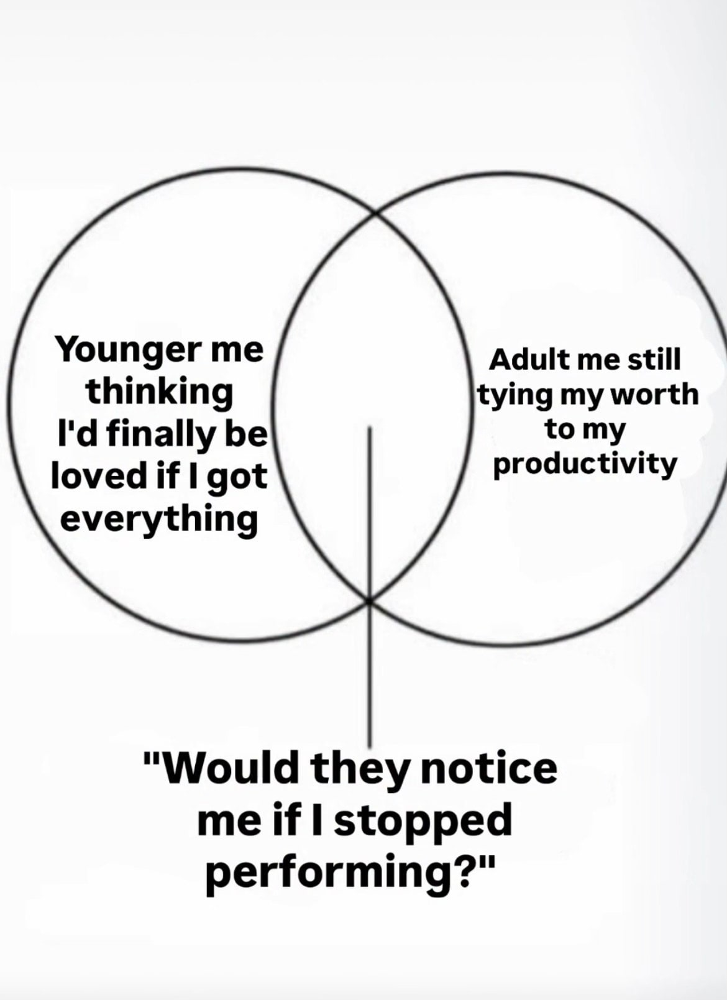
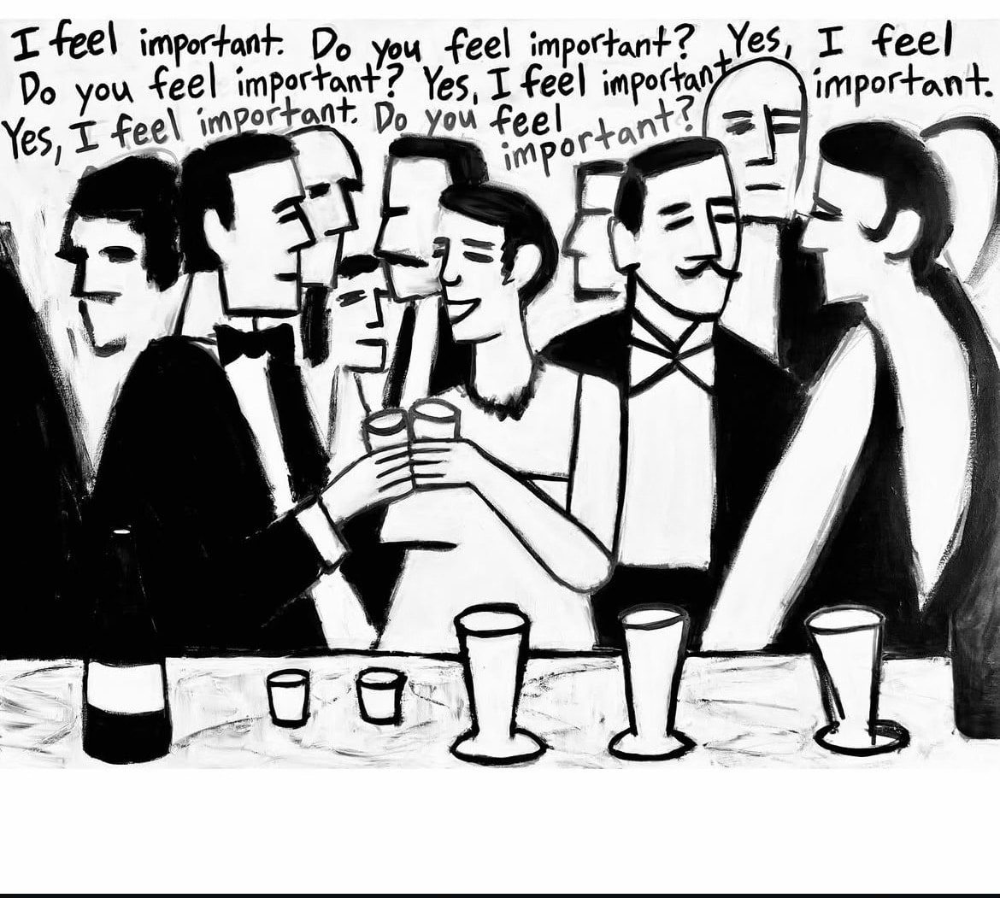

<!-- Imported verbatim from Substack (https://abhishekvyas02032001.substack.com/p/the-desire-to-be-seen), first published 2025-09-26T04:50:05.041Z. -->
Everyone wants to be seen, validated, encouraged, it’s one of the things still relevant across all strata of people i.e. we all just want to be SEEN.  

but this desire to be seen has turned the entire game, now to get seen people perform, they perform in front of their managers, their parents, their partners, their colleagues, even sometimes when no one is around because they’ve gotten so much into that character. This performance will be hard to keep up with, life doesn’t move around in 3 acts, life isn’t always rewarding for playing a good character, fyi good characters get killed first lol.

I know I’ve yapped in the previous paragraph but I was just building the base to let off some stuff, I think I’ve too performed my entire life, in school for teachers, in sports break for my friends even though I don’t like basketball that much but couldn’t say it out loud, at home for my parents being the sorted kid, in office not proving my point in front of my manager even though he is one of the dumbest people I’ve ever crossed paths with, I think resigning from the job, trying to build this startup was just my brain’s way of saying “Stop performing brother” and you know what over the years I’d gotten worse in performing, side eyes, clear disgust on the face, there were signs of a failing actor and I hope that actor always fails, there’s no need for that actor , the way I’m as a person is dramatic enough for this stupid little world.  

and to the question would they notice if I stopped performing? I think they shouldn’t, they should play out their character, their life however they want, it’s you stupid ass person who needs to stop noticing, do what you need to do, do what you want to do then there’s no performance, not for your parents, your girlfriends, your friends, etc

> “““Love is the only sane and satisfactory answer to the problem of human existence”  
> ~ Erich Fromm”  
> so start with yourself ”  
> ~ Abhishek Vyas

you started behaving/acting in a way by your own choice, fuck other reasons, at end of the day by sheer logic of survival you started acting a certain way but now there’s no need to do that anymore, the desire to be seen ultimately has to pass by fear of being seen, so what do you choose today?  

fear of being seen or desire of being seen????  
spoiler alert, in my opinion, both of them are wrong answers, choose yourself, rest fear or desire becomes irrelevant, so enough yapping for the day, back to try to build out this startup.

