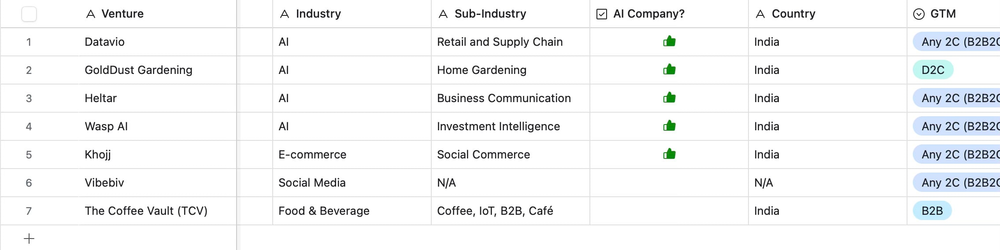

<!-- Imported verbatim from Substack (https://abhishekvyas02032001.substack.com/p/what-reddit-tells-us-about-the-future), first published 2025-09-27T07:00:15.441Z. -->
Every pitch deck says VCs are in the business of backing founders. But scroll through the right corners of Reddit, and you’ll see another story: small VCs drowning in emails, founders slipping through cracks, and partners juggling admin work that should’ve died with Excel 2003.  

The truth is blunt : small VCs don’t have the bandwidth of Sequoia or a16z. They run lean, sometimes with just a GP and an analyst. Yet, the *volume* of dealflow is relentless.

### Dealflow Deluge: 1,000 Decks, 10 Investments

In one Reddit thread, a user asked point blank: *“How the hell do small VCs manage their workflow?”*  
The top responses weren’t pretty: scattered Airtable sheets, broken CRM integrations, interns manually logging decks, and inboxes overflowing.

What emerges is a picture of **chaos disguised as hustle.** Small funds evaluate thousands of startups a year, often to make just a handful of investments. The problem isn’t *finding* startups; it’s triaging them without losing the rare outlier.

### Due Diligence: The Bottleneck Nobody Talks About

Another recurring theme: due diligence. One angel investor asked: *“How do micro VCs even run diligence with such small teams?”*

The answers revealed:

- Some skip formal diligence entirely for tiny cheques.

- Others rely on syndicate leads to shoulder the heavy lifting.

- A few outsource research to consultants or unpaid interns.

##### This creates a weird paradox : VCs demand meticulous data rooms from founders, yet behind the curtain their own diligence is patchy at best.  

### Enter AI (and the Hype)

Not surprisingly, AI is the new silver bullet in these conversations. Threads about *AI in VC workflows* are everywhere:

- *“Can AI screen decks and cut down 80% of noise?”*

- *“Could agents run diligence checklists automatically?”*

- *“Do we even buy into the hype around AI agents in venture?”*

There’s skepticism, but also curiosity. If small funds can’t hire 10 analysts, maybe they can spin up 10 AI agents. At the very least, automation could handle the boring 80%: deduping, verifying traction claims, enriching founder profiles.

## Founder-First Sourcing: A Contrarian Edge

One of the more refreshing takes came from a startup-focused subreddit: *“Can founder-first sourcing make early-stage VC more fair?”*

Instead of obsessing over the dealflow firehose, some funds are flipping the script:

- Scout networks to spot raw talent on campuses.

- Automated crawlers tracking GitHub velocity, hackathon winners, and Product Hunt launches.

- Scoring founders on grit, velocity, and obsession — not just polished decks.

This is how you escape the inbox trap: **opt-in sourcing built around people, not just pipelines.**

## So What’s Next?

Reddit paints a picture that rarely shows up in glossy VC interviews:

- Small funds are **overwhelmed and under tooled.**

- Diligence is **fragile and inconsistent.**

- AI is **promising but unproven.**

- Founder-first sourcing is **the quiet revolution.**

The invisible struggle of small VCs isn’t just an operational headache; it’s an existential risk. Miss a breakout founder because your Airtable was messy, and your fund math collapses.

That’s exactly why tools like **Wasp** are emerging, it already has two successful investments sourced and tracked through its workflow engine. By codifying founder signals and automating the messy middle of dealflow, it proves that lean teams don’t need to stay overwhelmed; they can actually *out-execute* larger funds with smarter systems.  

### Closing Thought

If you’re running a $10–50M fund today, your advantage won’t come from more decks in your inbox. It will come from **workflow innovation: scouts, automation, and yes : the right AI agents.**

The big funds will always have more money. But if you can build a **high-velocity, founder-first sourcing engine** with discipline or plug into platforms like Wasp that are already delivering results you can compete where it matters: spotting the unreasonable and unstoppable before anyone else.
