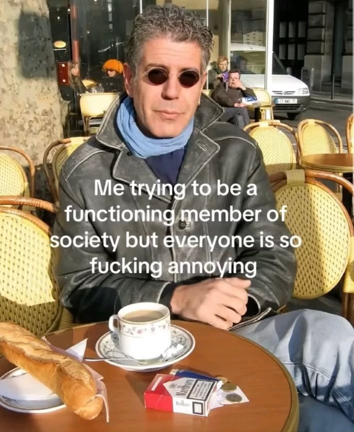
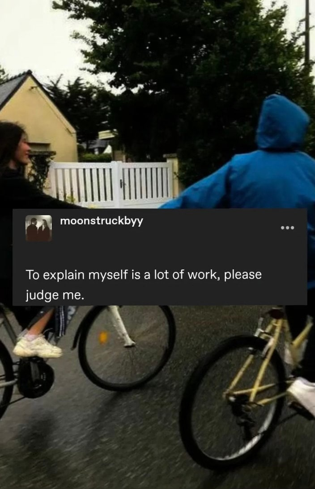

<!-- Imported verbatim from Substack (https://abhishekvyas02032001.substack.com/p/backside-of-your-favourite-notebook), first published 2025-09-28T10:25:41.958Z. -->
Everyone would that one notebook in their school time which was meant to be classwork/homework notebook but fate and you had different plans.  
You started to fill it with random games, gibberish, random communication between the classes, exchanging jokes, playing ‘BOLLYWOOD’, playing ‘X O’ , keeping up the CKT (hand-cricket) score tally on who’s leading and sometimes just you and your thoughts.

Recently I was in my hometown, went to my study room which first got converted into my sister’s study room which became the current ‘me-time’ room for my father, I saw an old notebook and at first I saw some formula, some equations and suddenly it turned all FUN, scribbling random convos between coaching lectures, random game that we invented of who could draw the longest with their non dominant hand, ahhh the simpler times.  

That got me thinking of ALL those half filled notebooks (from backside) which were the filler moments of my childhood, I think not only mine any little primary school kid’s childhood. It is this simplicity one still craves in this non-stop world, sometimes it’s about the simpler times and people with whom you can have those simpler times.  

I wrote a poem too about this but that’s on the end of this blog, one more point I had about that random scribbling, that’s still so relevant at least in my life.  
That backside became a full notebook, with nothing just me journalling about thoughts, startup ideas, GTM plan, revenue plan, poems, rage writing , that backside scribbling became the base of current thinking and planning, it was random back then but writing your thoughts makes them real, gives them an existence and sometimes that’s only thing we all miss, be so much in our heads we forget to just say it out loud or just write pages and pages about it.  

These daily blogs started as an ode to all those half filled, memory filled backsides which shaped me as a person so just writing for those simpler times.

Ahhhh the poem  

TITLE - “You’re the backside of my favourite notebook”  

My words

Scrambled

Suppressed

Shuffled,

People smirk,

Creating a mind so misty, unclear.

You are the backside of my favourite notebook,

Where all my thoughts, ideas, and theories lie,

A silent witness to my chaos, my fear,

A keeper of secrets I dare not clarify.

Your name,

Twisted in metaphors,

Present in every combination of RGB,

Like a prism that refracts my soul,

A spectrum only I can see.

You are the backside of my favourite notebook,

A blank canvas where my truths unfold,

The untamed scribbles of a heart unspoken,

Stories that will never be sold.

I’m the one who hides behind the page,

Crafting worlds in whispers,

Dancing between the lines of a quiet stage.

You are the backside of my favourite notebook,

A place where I begin and end,

A space that understands without question,

My companion, my shadow, my pen.

