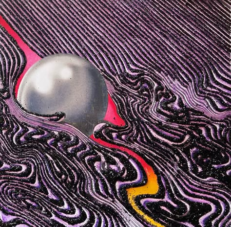
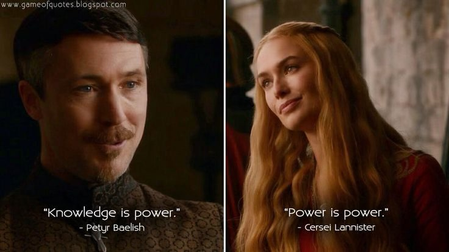

<!-- Imported verbatim from Substack (https://abhishekvyas02032001.substack.com/p/the-less-i-know-the-better), first published 2025-09-30T03:37:30.860Z. -->
Some songs don’t just get stuck in your head, they get stuck in your life.

*The Less I Know, The Better* has always felt like one of those.

A true bipolar song, the lyrics make the song sad, the bass makes the song sexy, guitar makes the song nostalgic and beat makes the song happy, it’s PERFECT

It’s not just a love story in three minutes it’s about how knowing too much can be its own kind of heartbreak. The more details you collect, the heavier it all feels. Sometimes ignorance really is a shield. Those little quotes at the end of our school diary were indeed very profound, “Ignorance is a bliss”

In maybe last 2-3 years, I catch myself in the same loop outside of music. In work, in everyday life, I want to know everything 🤡🤡🤡🤡

Every outcome, every reason, every what-if. But there’s a point where curiosity tips into obsession, and obsession tips into pain. Just like the narrator in the song, you start realizing: maybe it would’ve been easier if I hadn’t known at all.

And yet, there’s something freeing in pulling back. Not ignorance in the reckless sense, but a softer kind of letting go. Choosing not to refresh the feed again. Choosing not to dissect every word someone said. Choosing not to measure myself against everyone else’s pace.

The song reminds me: knowledge isn’t always power. In Cersei words, “POWER IS POWER”. Sometimes, power is protecting your peace.

Maybe that’s the real punchline: life isn’t ruined by what we don’t know, it’s ruined by those 3 a.m. deep dives we absolutely didn’t need.

So maybe the less I know the better.
