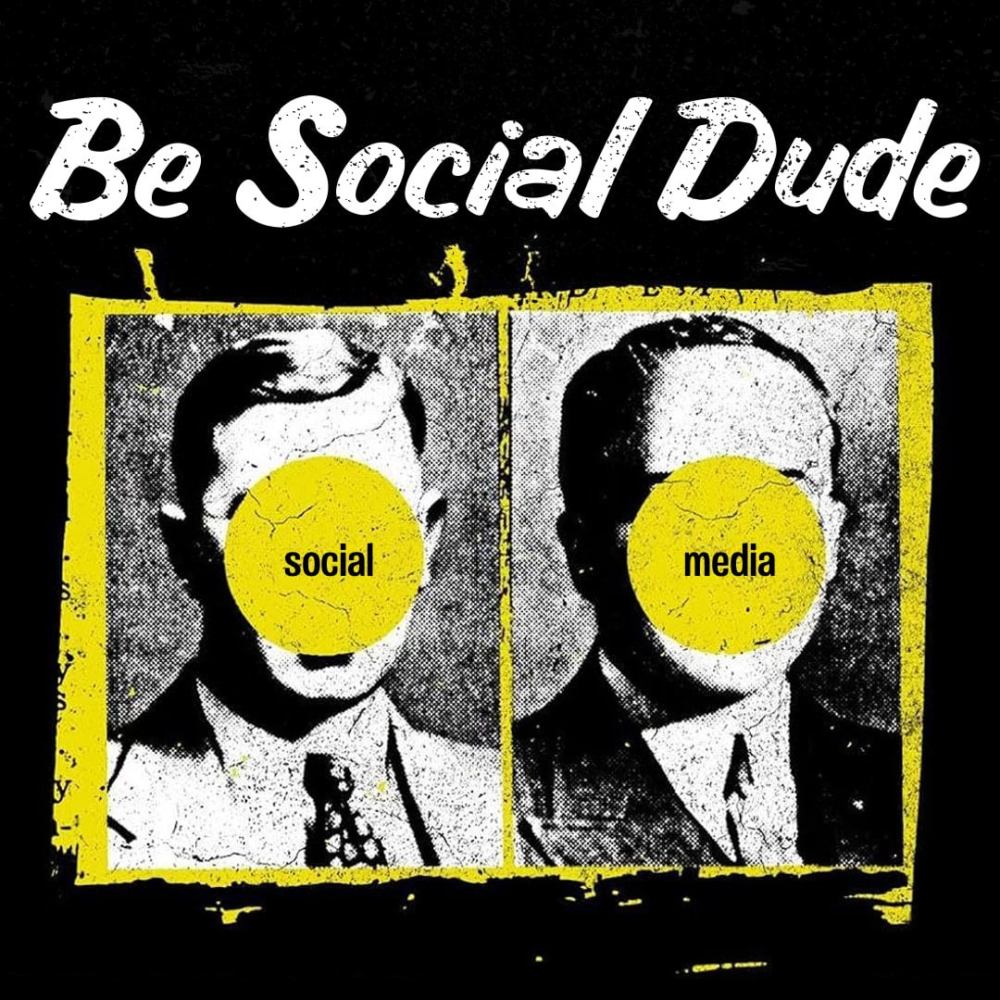
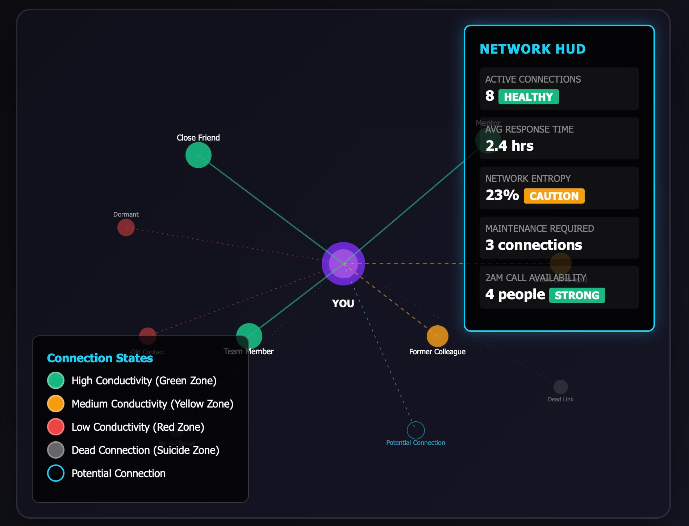

<!-- Imported verbatim from Substack (https://abhishekvyas02032001.substack.com/p/thermodynamics-of-social-connections), first published 2026-01-30T15:27:45.990Z. -->
> **“I’ve learned that people will forget what you said, people will forget what you did, but people will never forget how you made them feel.”**
> 
> **~Maya Angelou**

I’ve been thinking about relationships all wrong.

For years, many of us have treated our professional networks like inventory, counting LinkedIn connections, tracking business cards, maintaining contact databases. We measure our social capital in numbers: 5,000 connections, 1,200 followers, 47 mutual friends.

But here’s the uncomfortable truth: your relationships aren’t assets you own.

They’re energy fields that are constantly decaying.(I don't even know where the fuck half my school friends ended up)

## The Database Delusion

Think about your LinkedIn profile right now. It says you have thousands of connections. But ask yourself this: How many of those people would answer a 10:00 PM phone call and genuinely help you with the problem at work?

That’s the difference between inventory and conductivity.

Traditional databases assume relationships exist in a solid state, static, unchanging, stored until deleted. But physics tells us a different story. In the real world, energy dissipates unless it’s actively renewed. Your relationships follow the same law.

## The Maya Angelou Vector

Maya Angelou famously said, “People will forget what you said, people will forget what you did, but people will never forget how you made them feel.”

She wasn’t being poetic, she was describing physics.

What we call “feeling” is actually residual pull, the potential energy left behind after an interaction. It’s not about storing facts like “Kunal Shah is a CEO.” It’s about measuring the gravitational force Kunal Shah has toward you, and you toward him.

Data points like job titles, tenure, and mutual connections are lagging indicators. Feeling is the leading indicator. It’s the only persistent data that matters.

## The Silent Killer: Entropy in Your Network

The most dangerous state in any network isn’t conflict, it’s dormancy mimicking as strength.

A connection that appears solid on the surface might be silently decaying underneath. Every second of silence represents a microscopic erosion of pull. Leave a relationship unmaintained for too long, and something worse happens: the connection doesn’t just weaken, it creates resistance.

When you reach out to a high-resistance connection, your request doesn’t just get ignored. It can create a “burn effect,” actually damaging your social capital and credibility within the broader network. Silence isn’t neutral. It’s toxic.

## The Three Primitives of Pull

So how do we measure the true strength of a connection? There are three fundamental forces at play:

1\. Mirrored Response (Resonance)

The echo test. If you send a wave and no wave returns, the medium is dead. It’s not just whether someone responds, it’s whether their response mirrors your energy. Reciprocity is everything.

2\. Signal Velocity

Not just *that* you spoke, but the acceleration of the response. How quickly does someone reply? How enthusiastically? Speed and intensity reveal the strength of your bond.

3\. Time (Entropy)

The universal tax. Every moment of silence is a microscopic decay of pull. The duration and consistency of your interactions determine whether a connection thrives or withers.

## Check: Know Your Social Capital

Before you make that ask, send that message, or reach out for that favor, you need to know which zone you’re in:

- Green Zone: High conductivity. Safe to make requests.

- Yellow Zone: Moderate resistance. Proceed with caution.

- Red Zone: High resistance. Maintenance required before asking.

- Social Suicide Zone: Connection effectively dead. Any request will backfire.(been there many times, don’t do this kids)

The most socially intelligent people aren’t the ones with the biggest networks, they’re the ones who understand exactly where they stand with each person in their orbit.

## Building an Ethical Network

Here’s where this gets revolutionary.

Traditional networking operates on an extraction model: connect with people, extract value, move on when resources are depleted. It’s mining, not gardening.

The thermodynamic model suggests something different: an **Ethical Network** that prioritizes understanding and respecting the dynamic nature of human connections. Instead of treating people as resources to be tapped, we align with the current state of their attention and energy.

This isn’t just more moral, it’s more sustainable.

When you stop trying to extract value and start investing energy into maintaining authentic connections, you build an ecosystem where everyone can thrive through mutually beneficial relationships. You’re not burning through your network, you’re nurturing it.

## The Nervous System Approach

Imagine a “HUD” for human interaction, a heads-up display that shows you in real-time when you’re about to overstep your social capital. A system that:

- Passively monitors the rhythm of your network (not the words, but the energy)

- Calculates pull as a decaying vector sum

- Provides live warnings when you’re approaching high-resistance connections

This isn’t surveillance. It’s awareness. It’s about having the same sensitivity to social dynamics that successful people develop intuitively over decades but accessible to everyone.

## The Bottom Line

Your network isn’t a database. It’s not a collection of business cards or a spreadsheet of contacts.

It’s a living, breathing energy field that follows the laws of thermodynamics. Relationships decay without maintenance. Silence creates resistance. Momentum requires consistent energy input.

The question isn’t how many connections you have. The question is: How many connections would still conduct energy if you needed them today?

Stop counting inventory. Start measuring conductivity.

Your network is alive. Treat it that way.  

Sources to read:  
1) https://news.stanford.edu/stories/2023/07/strength-weak-ties

2)

> [Andrew Yeung (@andruyeung) on X](https://x.com/andruyeung/status/2012279940020875321?s=48)
