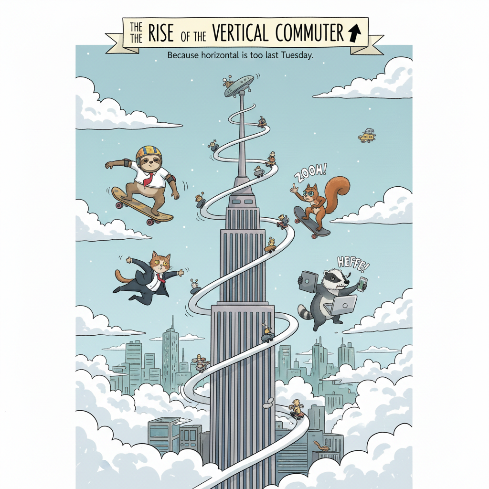

<!-- Imported verbatim from Substack (https://waspsignal.substack.com/p/the-rise-of-the-vertical-operator), first published 2026-02-02T01:55:15.990Z. -->
Most breakout companies are obvious in hindsight. But the earliest signals don’t come from pitch decks. They come from public traces:

- Institutional Leadership (E-Cell Mafia)

- Category Creation (Defining AEO era)

- Vertical Moats (OS for Real-World Value)

- Hyper-Velocity ( 0 →1 speed)

This week, Wasp’s agents flagged a specific evolution in the graph. While last week was about Enterprise Rails, this cohort is about Vertical Mastery. They aren’t just building AI; they are building the specialised operating systems for the world’s most fragmented industries.

Wasp Signals will be weekly. We don’t guess. We log the traces.

### 1) Viren Inaniyan (Asva AI)

LinkedIn: [viren-inaniyan](http://linkedin.com/in/viren-inaniyan) Product Website: [https://asvaai.com/](https://asvaai.com/)

Signals Observed

- The E-Cell Pedigree: Former Overall Head of E-Cell IIT Bombay. Running Asia’s largest business-model competition provides a unique dataset on why most startups fail at the product-market fit (PMF) stage.

- Product Maturity: PM at Teachmint and experience at Rakuten (Japan). He knows how to build “sticky” features that drive retention at scale.

- Category Creation: Building Asva AI, tackling AI Engine Optimisation (AEO), the successor to SEO.

Why This Matters  
Viren is solving the Visibility Gap as search behaviour shifts from blue links to synthesised answers (ChatGPT, Claude), Viren is building the infrastructure that ensures brands are actually cited and recommended by the agents.

### 2) Yash Choudhary (Stealth)

LinkedIn: [yash-choudharyiitb](https://www.linkedin.com/in/yash-choudharyiitb/)

Signals Observed

- YC & Floworks Pedigree: Yash cut his teeth as an NLP intern at Floworks (YC W23), building to make agents move from chatting to executing complex tasks as an AI Employee

- Vertical Moat (Commodities): Currently a Founder in Stealth, Yash is building the AI Stack for Commodities. He is diving into the $100T+ industry that in his own words “fuels and feeds the world,” tackling complex trade finance and risk management.

- Academic Hyper-Density: Master’s in ML & Data Science from IIT Bombay’s CMinDS with research at Harvard (Edge Computing lab).

- Hackathon Execution: A winner at SaaSBoomi WeekendHacks (2025). He moves from “what if” to “shipped code” in 28-hour sprints.

Why This Matters  
Yash represents the Hard-Vertical builder. By combining YC-backed agent automation with deep-tech research, he is uniquely positioned to automate the most fragmented, high-stakes sector: Global Commodities.

### 3) Karan Sawant (Hipo.ai)

LinkedIn: [karan-sawant](https://www.linkedin.com/in/karan-sawant/)

Signals Observed

- Founder Proof: Co-founded “Return on Search,” a platform for SERP analysis at scale. He has already proven he can build a product that enterprises value and exit successfully.

- Velocity as a Moat: His profile explicitly benchmarks an MVP within 3 weeks capability. In a market moving this fast, speed is the only defence against model commoditisation.

- Data Intensity: Previous experience as a Senior Data Scientist at Verox AI (New York), building forecasting models for 10,000+ crypto coins in parallel.

Why This Matters

Karan is a “Serial Deployment Engine.” While others are debating model ethics, he is shipping production-ready agents. His background in high-concurrency data is a direct prerequisite for the multi-agent coordination systems we expect to dominate the next 12 months.

### Meta-Pattern

This week we moved to Deep Verticalization. We are seeing a pivot away from horizontal AI towards builders who are boring into the bedrock of legacy industries.

The categories showing the strongest early traces:

- AEO (AI Engine Optimisation): The inevitable shift from ranking for humans to being cited by LLMs. As search traffic migrates to answer engines, the value moves from the click to the citation.

- Vertical Intelligence: Builders are abandoning superficial GPT-wrappers to tackle massive, high-friction markets like Commodities and Global Trade. These sectors require domain-specific execution layers where generic LLMs fail.

- Hyper-Velocity Ops: Why Zero to MVP in 3 weeks is the new standard. In a 2026 market, the ability to build and discard prototypes at high frequency is the only way to find the wedge before incumbents wake up.

If you’re building in these spaces or investing close to them, I’d love to stay in touch.

~Abhishek Vyas  
Wasp Signals
