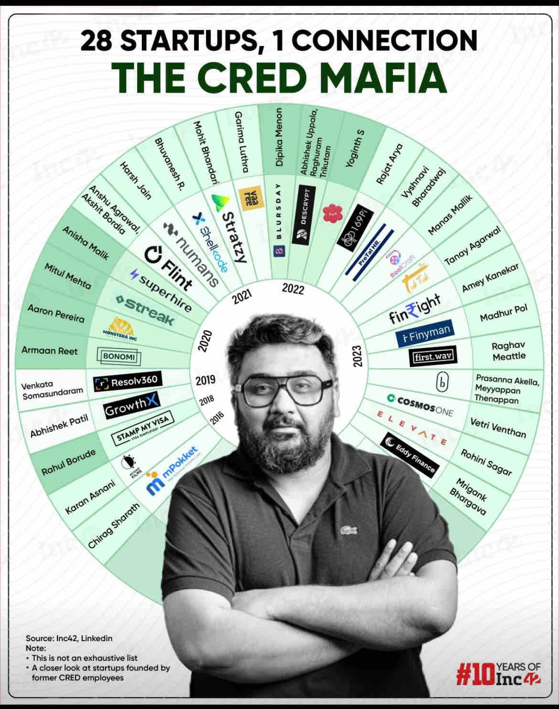

<!-- Imported verbatim from Substack (https://waspsignal.substack.com/p/from-inflection-to-ignition), first published 2026-02-24T05:04:54.847Z. -->
I kept reading CRED mafia, Razorpay Founders, I wondered what led to these people inflect and starting building their own startups!!  
The golden growth phase isn’t career fuel.  
It’s founder bootcamp.

Join during inflection:

- revenue 10×

- team 5–10×

- chaos maxed

You learn the full flywheel.  
Velocity under pressure.  
Distribution in the wild.  
Founder decisions at close range.

Most leave with scars.  
The best leave with superpowers.

India is entering that spin-out cycle now.

Ex-CRED. Zomato. Meesho. Sarvam.  
Operators turning founders. Quietly.

These are the clearest early signals I’m tracking.  
All stealth / early.

credit - grapevine

#### **Technical stack builders**

[Kaushik ASP](https://www.linkedin.com/in/kaushik-asp/)

Founding Engineer @ Emergent Labs (YC S24) → built 0→1 AI infra that scaled fast.

Hidden signal: YC playbook for lean, high-quality AI shipping  
Alpha: Builder now → back the heartbeat that scales alone

[Nischith Shadagopan M N](https://www.linkedin.com/in/nischiths/)

Founding member @ Sarvam AI → OpenHathi (Indic LLM), Sarvam Parse

Hidden signal: pre-train + fine-tune + synthetic data mastery  
Alpha: one of few in India who can build LLMs ground-up. Foundational IP bet.

#### **Demo → revenue operators**

[Saurav Agarwal](https://www.linkedin.com/in/agarwalsaurav/)

Product & Data Strategy @ CRED + Akaike

Hidden signal: applied AI in regulated environments  
Alpha: moves AI from demo → compliant revenue. Vertical execution edge.

#### **Systems & Growth PMs**

[Iqbal Baig](https://www.linkedin.com/in/iqbalbaigiqbalbaig/)

PM @ Meesho during hyper-growth + Principal PM @ Gameskraft → scaled high-concurrency consumer systems.

Hidden signal: understands operational complexity at scale and workflow automation  
Alpha: consumer-scale systems thinker now attacking legacy insurance ops

[Sumit Agarwal](https://www.linkedin.com/in/sumitagarwal280993/)

Program Manager @ Zomato East India → scaled city ad revenue from ₹60L → ₹1.5Cr in 4 months.

Hidden signal: deep visibility into restaurant economics + demand funnels  
Alpha: building F&B tech with insider unit economics edge

[Siddhant Tibdewal](https://www.linkedin.com/in/siddhant-tibdewal/)

Meesho + Kutumb operator; IIT Bombay → growth ops, diligence, and marketplace dynamics.

Hidden signal: hyper-growth playbook + disciplined execution lens  
Alpha: blends operator rigour with early-stage market discovery

#### **0→1 builders with velocity**

[Akram Tariq K.](https://www.linkedin.com/in/akram-tariq-khan/)

PM @ CRED (AdTech) + Media.net → scaled performance funnels and high-volume monetization; earlier built & scaled YourLibaas.

Hidden signal: understands traffic, monetisation, and creative optimisation at massive scale  
Alpha: combines AdTech velocity with operator hustle → distribution + revenue from Day 1

[Ojas Jain](https://www.linkedin.com/in/ojas-jain-iit/)

Engineer @ LAT Aerospace; IIT Bombay → P&G & Suntory Japan internships; HBS 2+2 admit; builder ethos.

Hidden signal: cross-discipline problem solving + global exposure early  
Alpha: raw founder energy with elite optionality → tinkering phase before breakout build

#### **Moat = distribution**

[Divyansh Sharma](https://www.linkedin.com/in/divyansh-sharma-li/)

Flipkart Mobiles Growth + Meesho APM

Proof: Shopsy Mobiles → ₹30Cr Month 1  
Signal: SummonLM (1000+ early DAU)  
Alpha: builds product → finds 10k users Day 1, Rare GTM DNA.

#### **Pattern**

Inflection scars → unfair founder edge.

What they carry forward:

- velocity discipline

- vertical depth

- sovereign technical capability

- distribution leverage

They are not theorising execution.  
They have shipped it.

Investor / operator / co-founder hunt?  
Ping them.

Early signals move fastest.

Next issue: vertical operators in insurance & F&B trenches

Subscribe for weekly signal logs.  
Execution > everything.

(Agent graph flagged all of these. Public sources only.)
