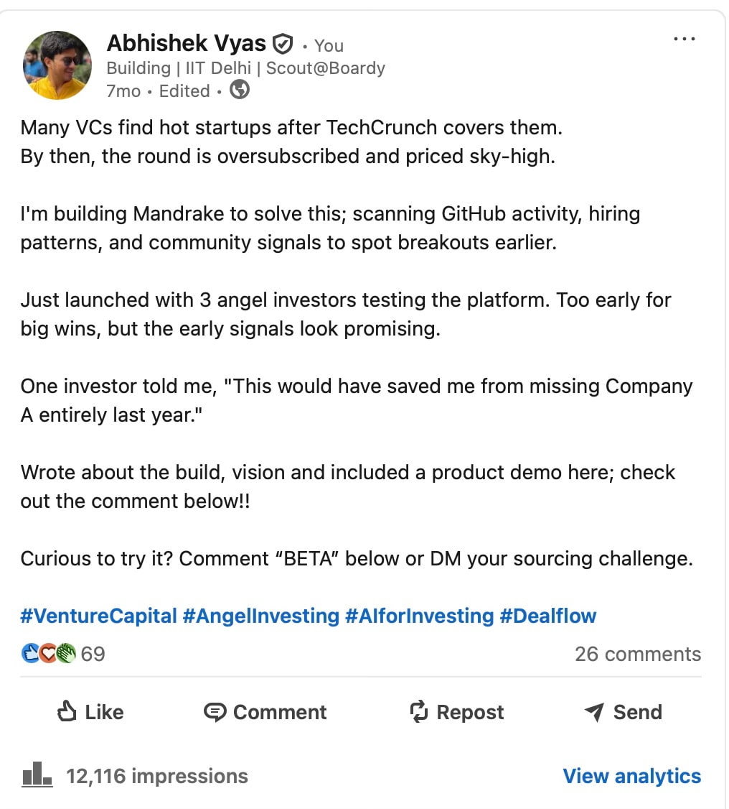
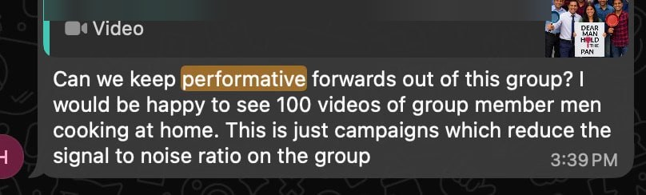

<!-- Imported verbatim from Substack (https://abhishekvyas02032001.substack.com/p/perform-this-is-gtm-dude), first published 2026-03-09T19:19:51.744Z. -->
I remember the day I hit ‘Post.’

I had just resigned. I was possessed by that specific, anything is possible energy of having a million thoughts and nowhere to put them. I was building Wasp (it was called Mandrake that time), and I did what everyone told me I was supposed to do. I wrote the “Founder Post.”

“I’m building Mandrake to solve this; scanning GitHub activity, hiring patterns, and community signals... Just launched with 3 angel investors... Curious to try it? Comment ‘BETA’ below.”

At the time, I thought I was being transparent. I thought I was “building in public.” I was sourcing founders who were doing the same, looking for those “early signals” in the noise.

I stopped writing for a while, and in that silence, I got wrecked. Not by the work, but by the realization of what the “startup scene” had actually become. When I finally looked up from the code, I didn’t see builders anymore. I saw actors. Sadly I was one of them too!!

**The Performance Economy**

I spent time in Mumbai recently, and I had the misfortune of meeting them: the Content Entrepreneurs.

These aren’t founders. They’re influencers cosplaying as builders. “Building in Public” isn’t their documentation, it’s their entire business model. A special genre of career exhibitionism dressed up as transparency.

They aren’t tracking metrics. They’re optimizing engagement rates.

They’re not solving problems for users. They’re manufacturing problems for content: “Day 47 of getting ghosted by VCs” and “Here’s my brutal feedback from YC application” and “Crying in the bathroom between investor calls, this is what grit looks like.”

It’s exhausting to watch.

**The Cycle**

Here’s the pattern I keep seeing:

Act 1: The Launch Post. Vague mission statements. Token traction. “DM me for early access.”

Act 2: The Struggle Content. Vulnerability theatre. Screenshots of rejections. Performative all-nighters with the laptop glow lighting their face just right.

Act 3: The Pivot Announcement. “After listening to our community...” (Translation: the first thing didn’t get enough likes)

Act 4: The Shutdown Elegy. The real finale. Maximum sympathy. “To my incredible team who believed when no one else did”, the same team they couldn’t afford to pay because they spent more time on Twitter Spaces than understanding unit economics.

And then? Soft reboot. New bio. New venture. Same show.

**My own blind spot**

The irony isn’t lost on me. Mandrake was designed to find signal in the noise, to identify who’s actually shipping versus who’s just posting. But the more I look at this landscape, the more I realize the real builders have gone underground.

The companies that matter aren’t announcing their seed rounds with cinematic LinkedIn carousels. They aren’t doing “founder photoshoots” or quote-tweeting their own cold emails. They’re in the trenches because they’re too busy solving actual problems to narrate solving them in real-time.

I used to think everyone writing online was just processing out loud, trying to think clearly. I didn’t realize that for so many, the processing IS the product. The startup is set dressing. The real business is the personal brand.

**What matters**

Maybe I still continue building or give up for a while. But I’m done performing.

If I write, it’s because the pressure of unspoken thoughts becomes unbearable not because I need to feed the algorithm or manufacture relatability.

The moment you catch yourself optimising for applause instead of outcomes, it’s over. The people who actually matter, the ones who can tell the difference between shipping and storytelling, they see right through it.

So from here on, I’m out, Comment “Number of fucks for your opinion/post” and I’ll send you 0 as a playbook and answer :))

