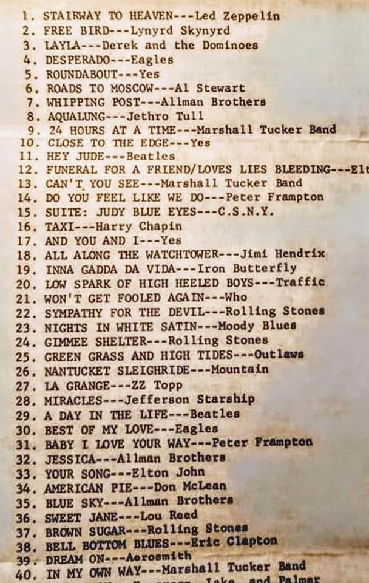
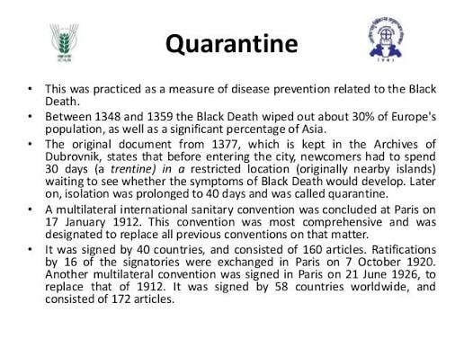
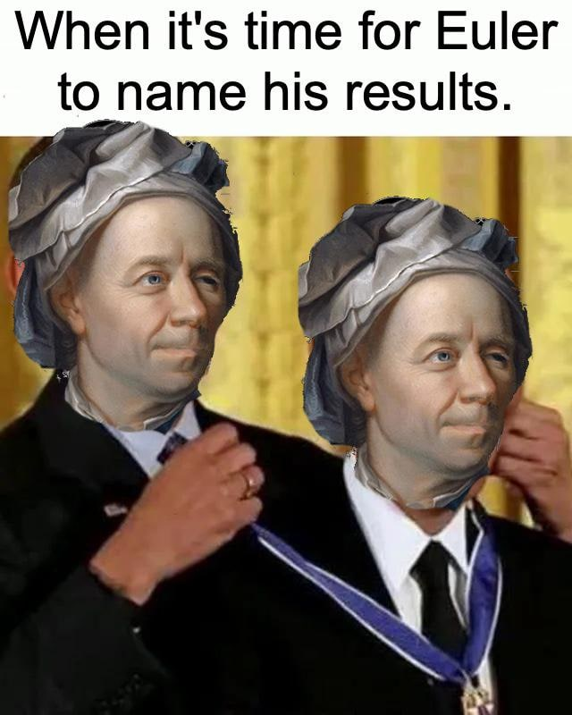
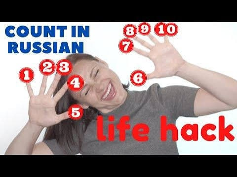
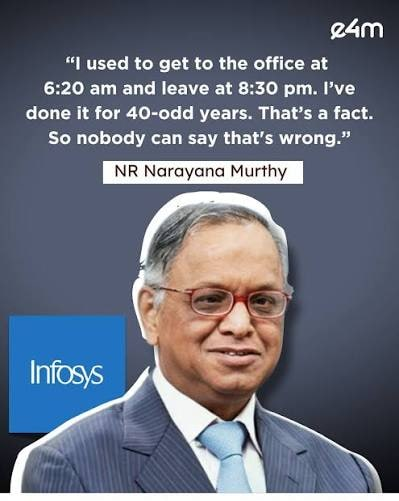
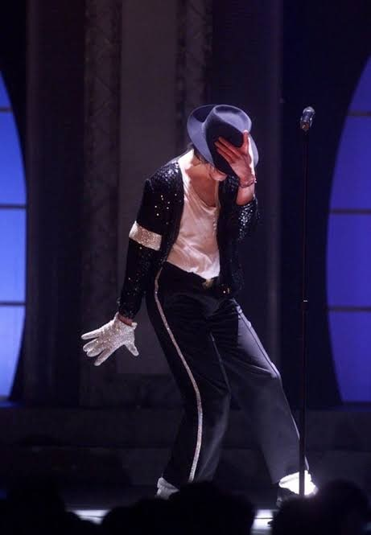
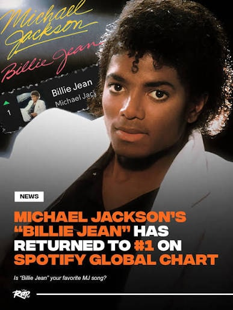

<!-- Imported verbatim from Substack (https://abhishekvyas02032001.substack.com/p/4042-forty-is-the-answer-for-everything), first published 2026-08-21T02:29:59.354Z. -->
In the book, The Hitchhiker’s Guide to the Galaxy by Douglas Adams the planet sized computer to figure out ‘the answer to the Ultimate Question of Life, the Universe and Everything’, after seven and a half million years, it returned the answer as —>“42”  

On 3 November 1993, a question was put to him: Why 42? Adams replied that it was a joke, he just needed an ordinary smallish number and in split second decided 42 and typed it, huge grave mistake.  

Today with this blog, I’ll try to shed some light on why the number 40 has the ‘right’ to be answer of ultimate question of life, if a number ever would be an answer. It isn’t an ordinary number like ‘42’, it never got someone to speak up for it but today I take on this challenge  

**ARGUMENT I - TOP-40**  

Post World War II, radio had expanded so much in numbers in early 1950s America but in the same decade once television became popular, radio had to take a big hit. Audio dramas, variety programs shifted to television or just left the air, television grew more very quickly despite its high cost at the time so it was a race for survival for radio  

here comes our hero, ‘Todd Storz’ (Omaha, Nebraska), he saw a strategy that people kept playing same few songs on the jukebox, they also used the list option in the jukebox to play those 40 songs, I repeat 40 songs (few more of these jukebox stories have grown in the retelling and nobody can fully verify it now, but forty is the number that stuck)  
So Storz and team created the ‘Top-40’ format, on the exploding records, weather and whatnot. Consequently there were big national shows such as 'American Top 40', a syndicated countdown of the 40 highest ranked songs, counted straight off the 'Billboard Hot 100'  

Rock ‘n’ Roll music made the ‘Top 40’ as big as it gets, Elvis Presley was the first rock superstar to help establish the Top-40 as something legit to follow for new upcoming artists and best of the music out there  
This just created the butterfly effect for the establishment of iconic Top40 radio stations across US, radio jingles, selling of vinyl records, artists craving for more and more Top 40 songs, all of this because jukebox at that time had list of 40 songs  
Nobody has ever seriously proposed a Top 42 and they shouldn’t  

**ARGUMENT II - Quarantine**  

Do you remember covid times, do you remember the word ‘quarantine’, do you remember how you’d need to get quarantined if you got any symptoms according to a forwarded message from ‘that’ uncle on the whatsapp group  

Actually the word “quarantine” doesn’t mean isolation, it means forty, sorry FORTY!!!!  
In 1300s, the Great Council of Ragusa ordered that any arrivals from plague affected area to undergo isolation for thirty days, a ‘trentino’. Over the following decades, other port cities and councils extended the period to forty days and the practice became 'quarantena', from \*quaranta giorni\* i.e. forty days. The reasons are lost to history, most probably because the Council members weren't journalling daily, taking ice-baths and nobody bothered to write down why thirty became forty; the leading guess is their own cultural preference for round figures (I, too, start any work at round figures)  

VERY fast forward to 2020, the entire planet was shut and forced to lock itself indoors to not get the coronavirus, anyone showing symptoms was advised to go for a quarantine for 14 days, the word still governed the global public-health vocabulary, even after more than 600 years, even when its arithmetical significance had dropped but it was still functioning properly, that my readers is the power and magic of number 40  

after 600 years, forty was still relevant and 42 was just a T-shirt size  

**ARGUMENT III - Maths**

Euler’s streak  
He observed that the quadratic equations

n2  \+ n + 41 and n2  \- n + 41

produce 40 consecutive prime numbers for n=0,1,2,…..39. That 41 sitting inside is what mathematicians call a lucky number of Euler, there are only six of them in existence (2, 3, 5, 11, 17, 41) and 41 is the largest, and that is exactly why its run is the longest one this family of quadratics can produce and mathematics doesn’t offer such clean consistency to just any number, suck it 42

Forty is the only number in English whose letters appear in alphabetical order, yes you read it correct, THE ONLY NUMBER  
Let it sink in, try out other numbers to disprove this argument (I did that as well).  
Now let us try for ‘forty-two’, shame to even try, suck it again 42

–40 °C is identical to –40 °F , the unique point at which the two common temperature scales agree.

In East Slavic languages the word ‘sorok’ displaced the regular “four-tens” form because it originally denoted a bundle of forty sable pelts, it is also the exact quantity required for one full-length coat

None of these facts are world-altering but they do demonstrate a pattern that whenever a system, need a medium sized human scale integer that divides clearly and helps them keep the pattern intact, they use 40 or a sorok  

**ARGUMENT IV - Forty hour week**  

A figure consistent through the decades post being popularise by Henry Ford, Labor laws, a baseline against which almost every appraisal meeting, measurement of work goes through, a system of work which Narayana Murthy hates, 40 hour/week  

Forty with such a grace, organises the ordinary life, let me paint a picture, your week started strong, you killed it on Monday, Tuesday and Wednesday, the feeling that you need to chill out now for the next days and then wake up again at 3 pm Friday, that feeling is caused by forty, this number tries to enforce work life balance, we never saw the potential but 40 did its job  
THANK YOU 40

Even he did it for 40 odd years, 40!!!

**CLOSING ARGUMENT**  

I came to this thought while listening to the G.O.A.T. Michael Jackson’s Billie Jean song, actually I’m still listening to it while typing, still listening, now I have paused because the joke died.  

In second verse, in a song and THE album which has transformed pop, its history, its global pull and its electric nature, he opens up a paternity accusation by a girl, for a stretch of forty days and forty nights, the law was on her side  
A man timekeeping against a woman with law and lawyers on her side, a woman who wasn't even his lover, with a kid that was definitely not his son  

Forty days and forty nights.

MJ didn’t invent that phrase and he didn’t have to explain it either. It’s the flood, Moses on the mountain, forty years in the wilderness, the exact stretch of time that every culture downstream of that story reaches for when it means long enough to change a man, short enough to still count.  

The Hanuman Chalisa is forty verses long, and chalisa just means forty, the poem is named after its own length, the same way quarantine is named after its own. Two completely unconnected civilisations, and both of them ended up with a text whose title is a number.

Six hundred years after the Ragusa council’s law in modern day Croatia, forty is still quietly running the world’s quarantines, its work weeks, its radio charts and its pop lyrics, doing the infrastructure work while 42 gets the T-shirts and the towels.  

**SOURCES**

- Douglas Adams, statement on alt.fan.douglas-adams, 3 November 1993.

- Douglas Adams, quoted in various interviews and the published radio scripts; also M.J. Simpson biography extracts.

- P.S. Sehdev, “The Origin of Quarantine,” \*Clinical Infectious Diseases\* 35 (2002); CDC Emerging Infectious Diseases etymology note (2013); archival records of the Republic of Ragusa.

- Todd Storz / KOWH histories (Nebraska State Historical Society; Ben Fong-Torres, \*The Hits Just Keep on Coming\*; Richard Fatherley research).

- Standard Russian etymological dictionaries (Vasmer et al.); scholarly notes on the sable-pelt trade unit.

- David Wells, \*Curious and Interesting Numbers\*, 2nd ed. (1997); subsequent linguistic confirmations.

(Additional popular-fact compilations and secondary cultural sources available upon request; they independently surface the same dense cluster of forty-related phenomena and are therefore admissible as evidence of ambient cultural preference.)
